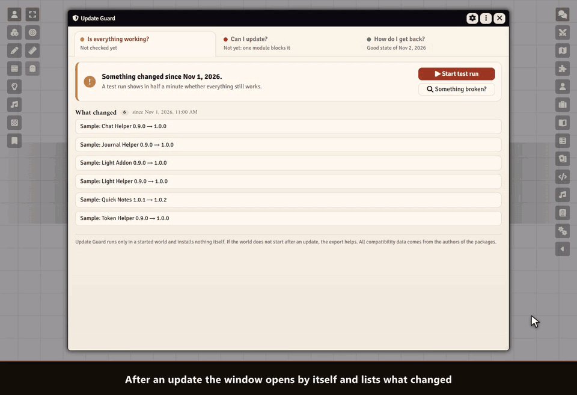

# Sephral’s Update Guard

**Is my world ready for tonight? One click answers it for you and your players. If something broke, Update Guard finds the module behind it, helps you report it, and shows you what is ready for the next Foundry and how to get back.**

[](#install)
[](https://discord.gg/7BjCgDYaBP)
[](https://github.com/Sephral)



## Highlights

* **Ready for tonight?** One click before the session: a test run, the errors your players had, and whether their browsers run the same versions as yours. One answer and one next step.
* **Errors of your players:** a module breaks in a player's browser and you hear about it, with the module, the player, the place and how often, plus a quiet notice during play. Players see nothing, and nothing personal is sent.
* **Report in one step:** for the module to blame, Update Guard checks on your click whether the problem is known on GitHub and writes a ready bug report.
* **Test run:** one click opens what a game night opens, sheets, journal, chat cards, scene tools, settings, and closes it again. You see which module threw an error and where. Your world is not changed.
* **Find the module:** no error says why something fails? The search suspects what changed and what your players' errors point at, and after a few rounds the module is known and everything is as it was.
* **Can I update?** Pick a Foundry version and see in one sentence what stands in the way. Before you update, save your module list as a loadout and get a reminder for the backup.
* **Newer versions on your click:** asks the public package list of The Forge what is new. The window tells you what is sent first.
* **What changed and the way back:** every change with its changelog, the last state that worked, and the steps back in Foundry's setup.

## How it works

1. Enable the module.
2. Before the session click *Ready for tonight?*. After an update the window opens by itself.
3. All good? Play. Something wrong? Report it, switch the module off or let the search find it.

## Good to know

Update Guard runs only in a started world and cannot install or roll back anything, because Foundry does that on its setup screen. It shows the way and gives you the addresses. Verified means what the author wrote into the manifest, it is no promise that nothing breaks. Only the GM sees the windows. Players send short error reports in the background, which you can switch off.

## Install

Update Guard is not in Foundry's module search. Copy this link:

```text
https://github.com/Sephral/sephrals-update-guard/releases/latest/download/module.json
```

1. In Foundry's setup screen open **Add-on Modules** and click **Install Module**.
2. Paste the link into **Manifest URL** at the bottom of the window.
3. Click **Install**, then enable the module in your world.

On The Forge open the Bazaar, click **Install From Manifest** and paste the link.


Foundry VTT 13 and 14 · any game system · English and German

## Learn more

What each rating means, what the players' browsers and the online check send, and every setting are explained in the [manual](MANUAL.md). Questions or ideas? Join us on [Discord](https://discord.gg/7BjCgDYaBP). Looking for more? See [all modules by Sephral](https://github.com/Sephral).

## License

See [LICENSE.md](LICENSE.md).
